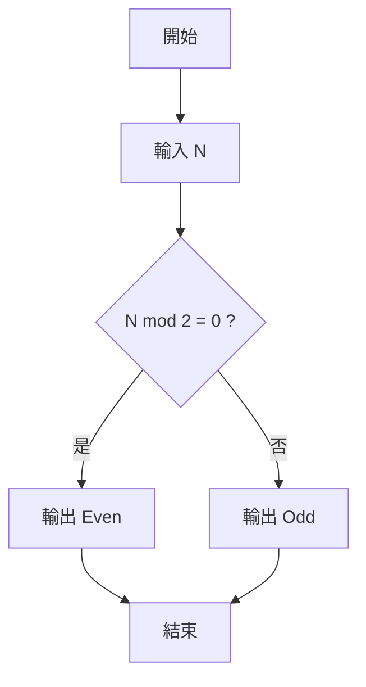
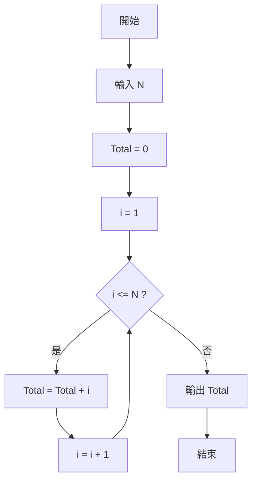
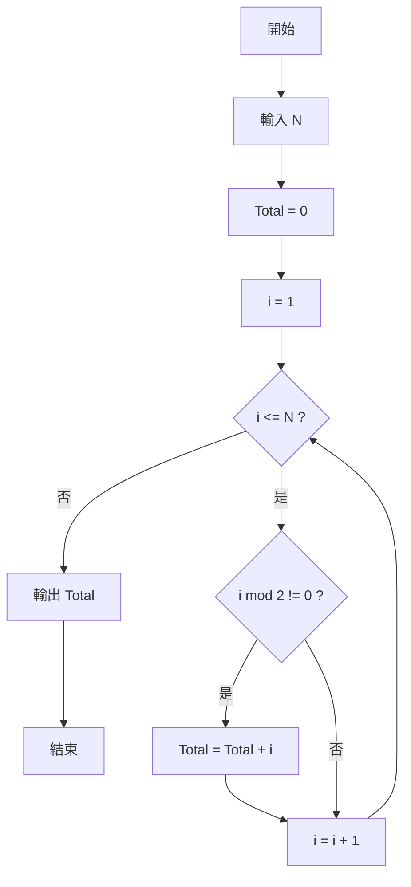

# 1. 輸入一個數，判斷奇數或偶數（Odd or Even）

## 流程圖步驟說明

1. 開始
2. 輸入整數 `N`
3. 判斷 `N mod 2 = 0`
4. 若成立，輸出「Even」
5. 否則輸出「Odd」
6. 結束

### 數學式（LaTeX）

若：

$$
N \bmod 2 = 0
$$

則為偶數（Even）。

否則：

$$
N \bmod 2 \neq 0
$$

則為奇數（Odd）。

## Mermaid 流程圖



---

# 2. 輸入一個數 N，計算 Total = 1 + 2 + 3 + ... + N

## 流程圖步驟說明

1. 開始
2. 輸入 `N`
3. 設定 `Total = 0`
4. 設定 `i = 1`
5. 判斷 `i <= N`
6. 若成立：
   - `Total = Total + i`
   - `i = i + 1`
7. 回到步驟 5
8. 若不成立，輸出 `Total`
9. 結束

### 數學式（LaTeX）

$$
Total = \sum_{i=1}^{N} i
$$

亦可化簡為：

$$
Total = \frac{N(N+1)}{2}
$$

## Mermaid 流程圖



---

# 3. 只累加奇數：Total = 1 + 3 + 5 + ... + N

## 流程圖步驟說明

1. 開始
2. 輸入 `N`
3. 設定 `Total = 0`
4. 設定 `i = 1`
5. 判斷 `i <= N`
6. 若成立則判斷 `i mod 2 != 0`
7. 若為奇數：
   - `Total = Total + i`
8. `i = i + 1`
9. 回到步驟 5
10. 當 `i > N` 時輸出 `Total`
11. 結束

### 數學式（LaTeX）

$$
Total = \sum_{i=1}^{N}
\begin{cases}
i, & i \bmod 2 \neq 0 \\
0, & i \bmod 2 = 0
\end{cases}
$$

例如：

$$
N = 9
$$

則：

$$
Total = 1 + 3 + 5 + 7 + 9 = 25
$$

## Mermaid 流程圖



---

# 三種程式結構比較

## 範例一：選擇結構（Selection）

判斷奇偶數：

$$
N \bmod 2 = 0
$$

```text
開始
 ↓
輸入 N
 ↓
條件判斷
 ↓
輸出結果
 ↓
結束
```

---

## 範例二：重複結構（Loop）

計算：

$$
1 + 2 + 3 + \cdots + N
$$

```text
開始
 ↓
初始化
 ↓
迴圈累加
 ↓
輸出結果
 ↓
結束
```

---

## 範例三：巢狀判斷 + 重複結構

計算：
$$
1 + 3 + 5 + \cdots + N
$$

```text
開始
 ↓
初始化
 ↓
迴圈判斷
 ↓
奇數判斷
 ↓
累加
 ↓
計數器加一
 ↓
回到迴圈
 ↓
輸出結果
 ↓
結束

對應高中程式設計三大結構
範例	程式結構
奇偶數判斷	選擇（Selection）
1+2+3+...+N	重複（Loop / Iteration）
1+3+5+...+N	巢狀選擇 + 重複（Nested Selection + Loop）
```
